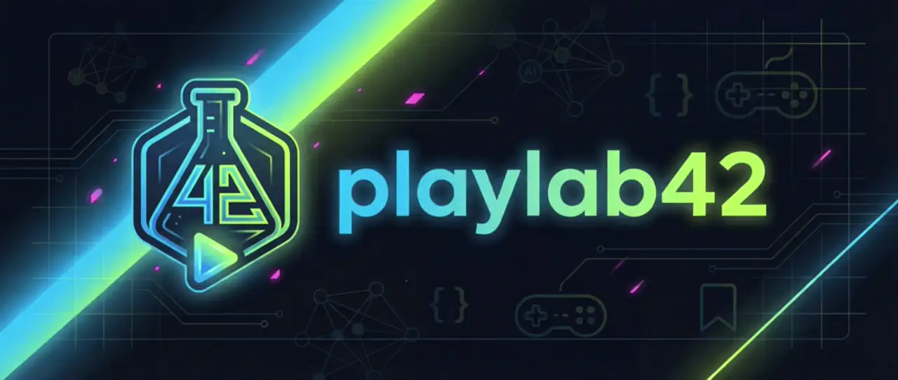
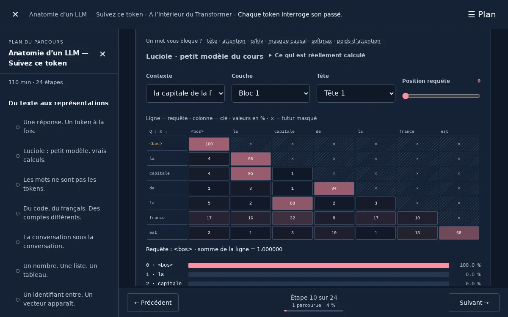
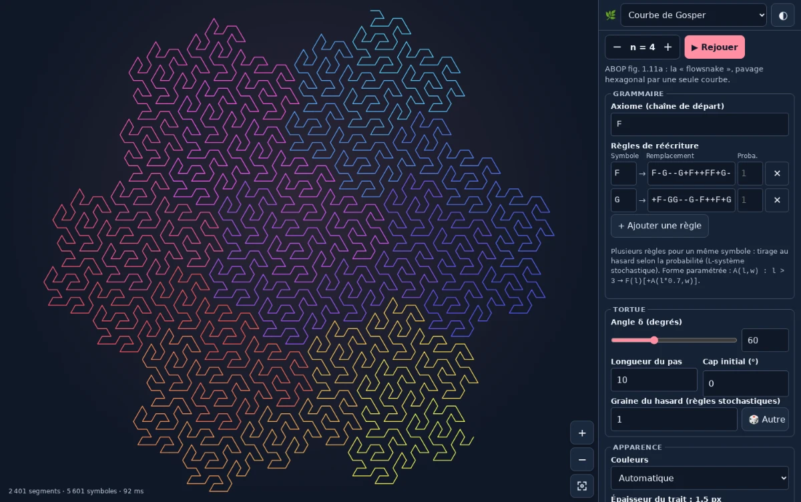
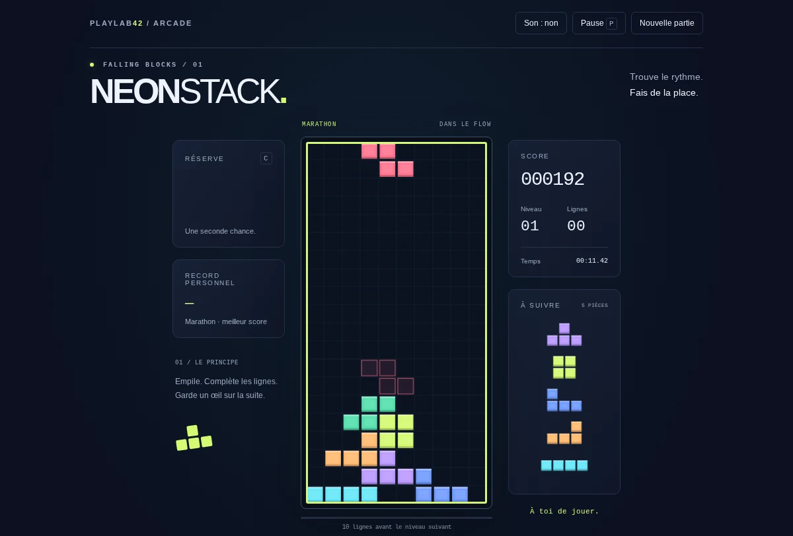
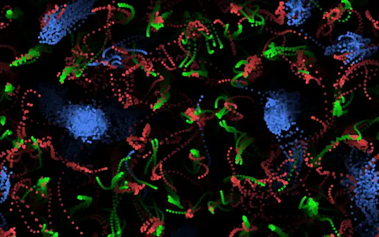
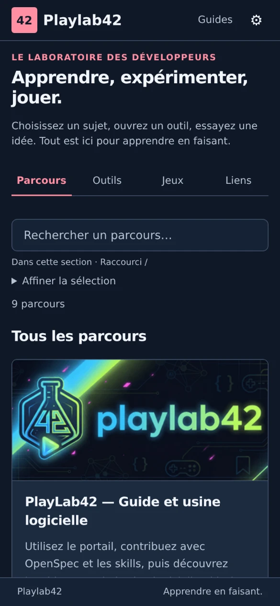

<div align="center">

<sub>[🇫🇷 Français](README.md) · English</sub>

<picture>
  <source media="(prefers-reduced-motion: reduce)" srcset="assets/banner.png">
  
</picture>

# Playlab42

**Understand AI. Experiment through play. Build together.**

An open, browser-based learning lab: interactive courses, tools, games and resources to learn AI and AI-assisted software development.

> **Heads-up: the platform and all its content are in French.** This page is an English overview of the repository; the courses, tools, games and documentation are written in French.

[](https://z4ppy.github.io/playlab42/)

[](https://github.com/z4ppy/playlab42/actions/workflows/ci.yml)
[](LICENSE)
[](CONTRIBUTING.md)

</div>

## What’s inside

**About ten courses, as many tools and simulations, a set of games** and a curated link library, with no account and nothing to install.

<table>
<tr>
<td width="33%"><a href="https://z4ppy.github.io/playlab42/#/parcours/anatomie-llm"></a><br><b>Courses</b> · a token through an LLM</td>
<td width="33%"><a href="https://z4ppy.github.io/playlab42/tools/l-systems/"></a><br><b>Tools</b> · grammar → shape</td>
<td width="33%"><a href="https://z4ppy.github.io/playlab42/games/tetris/"></a><br><b>Games</b> · tested rules, bots</td>
</tr>
<tr>
<td colspan="2"><a href="https://z4ppy.github.io/playlab42/tools/particle-life/"></a><br><b>Simulations</b> · Particle Life, a few rules and a world emerges</td>
<td align="center"><br><b>Mobile</b> · works on phones too</td>
</tr>
</table>

**First visit?** Open [the demo](https://z4ppy.github.io/playlab42/) and start with the [“PlayLab42 — Guide et usine logicielle”](https://z4ppy.github.io/playlab42/#/parcours/hello-playlab42) course (a tour of the platform and its software factory).

## Why Playlab42

- **Nothing to set up.** It’s a static site: your preferences, scores and progress stay in your browser. Light and dark themes, keyboard navigation.
- **Learn by doing.** Courses embed real, hands-on demos: attention grids, tokenizers, neural networks, simulations.
- **A real project, in the open.** Deterministic game engines, Jest and Playwright tests, OpenSpec specs, CI/CD and security audits: good practices are shown, not just described.
- **Built to be extended.** One manifest, one folder, one pull request: your tool, game or course joins the catalog.
- **Ready for AI agents.** [Agent instructions](AGENTS.md) and [project skills](docs/guides/project-skills.md) are versioned with the code.

## Quick start

Requirements: Git and [Node.js](https://nodejs.org/) 24 or later. It takes about 2 minutes.

```bash
git clone https://github.com/z4ppy/playlab42.git && cd playlab42
npm ci
npm start        # then open http://localhost:5242
```

Prefer Docker, or need to work on several branches at once? The [getting started guide](docs/GETTING_STARTED.md) (in French) covers the Docker environment, day-to-day commands and optional extras (GPT-2 lab, link previews).

## Contributing

A small contribution can become great training material: a tool, a game, a bot, a course, a resource, a fix. Everything is summarized in [CONTRIBUTING.md](CONTRIBUTING.md); questions and ideas go through the [issue templates](https://github.com/z4ppy/playlab42/issues/new/choose). Note that the project is run in French: issues, commits and code comments.

## Documentation

All documentation is in French.

| To… | Read |
|-----|------|
| Install and work day to day | [Getting started](docs/GETTING_STARTED.md) |
| Understand the architecture and stack | [Architecture](docs/ARCHITECTURE.md) |
| Create a tool, a game or a course | [Guide index](docs/guides/README.md) |
| Concepts, testing, deployment, troubleshooting | [Concepts](docs/CONCEPTS.md) · [Testing](docs/TESTING_STRATEGY.md) · [Deployment](docs/DEPLOYMENT.md) · [Troubleshooting](docs/TROUBLESHOOTING.md) |
| Follow the project’s history | [Changelog](CHANGELOG.md) · [OpenSpec specifications](openspec/specs/) |

Security: [SECURITY.md](SECURITY.md), never through a public issue · Community: [code of conduct](CODE_OF_CONDUCT.md) · Thanks to all [contributors](https://github.com/z4ppy/playlab42/graphs/contributors)!

## License

A personal project by Cyrille ([@z4ppy](https://github.com/z4ppy)), open to contributions and released under the [Apache 2.0](LICENSE) license (see the [NOTICE](NOTICE)). Third-party components (`vendor/`, tokenizers and models from the “Anatomie d’un LLM” course, etc.) keep their own license, stated in their folder.

---

*Why “42”? A nod to Douglas Adams and the Ultimate Question of Life, the Universe and Everything. Here, we start by experimenting.*
