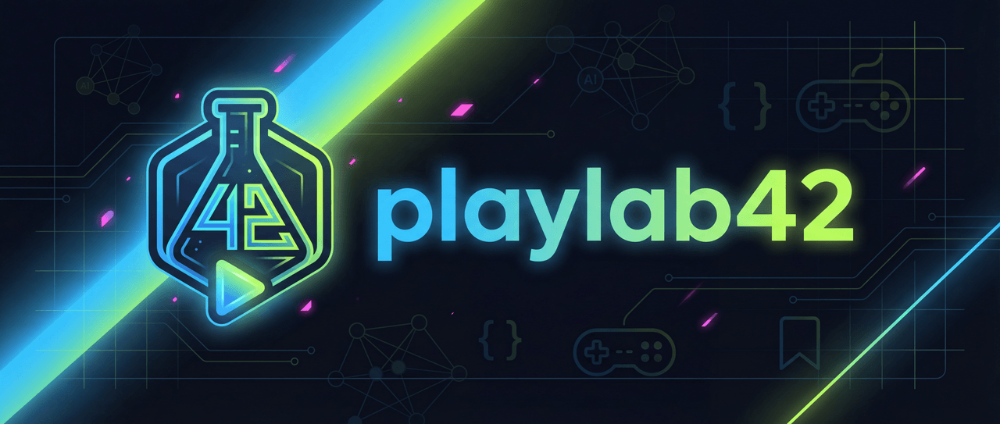
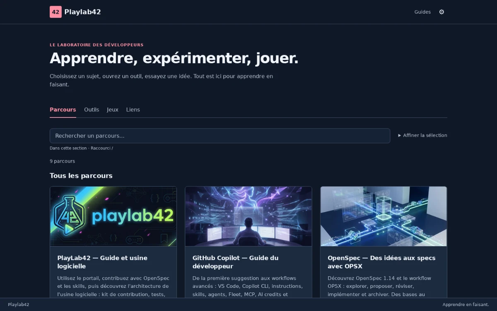
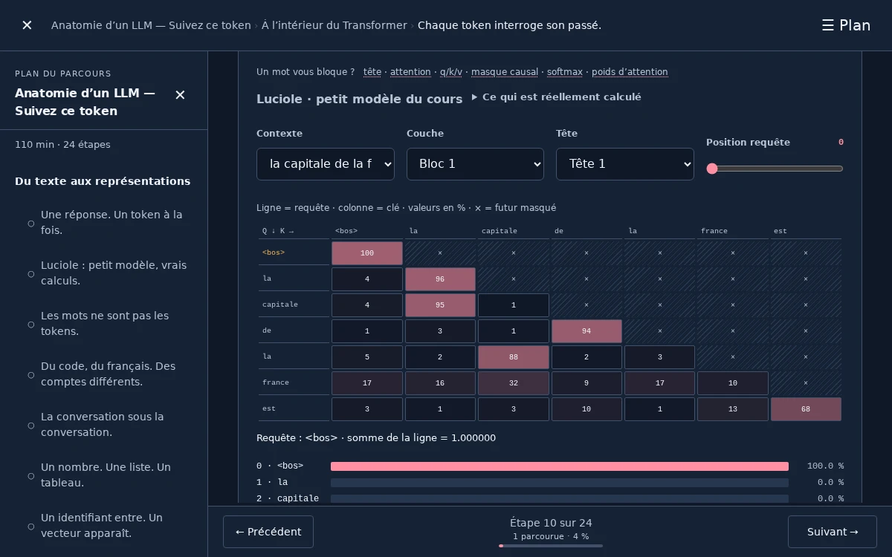
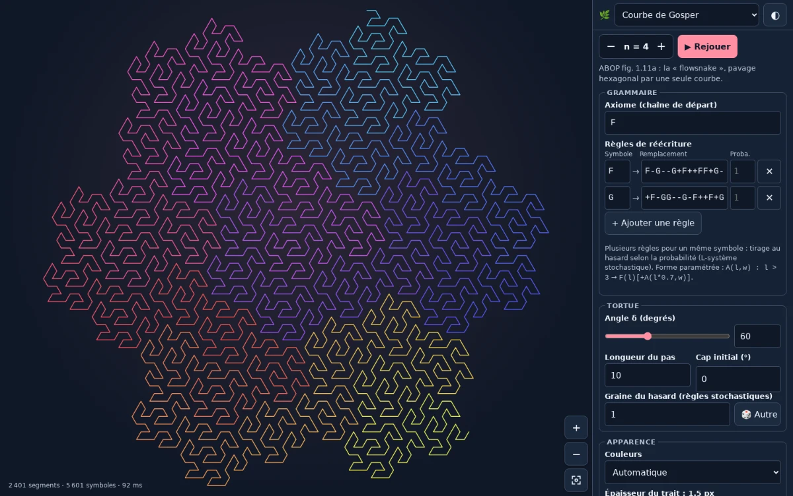
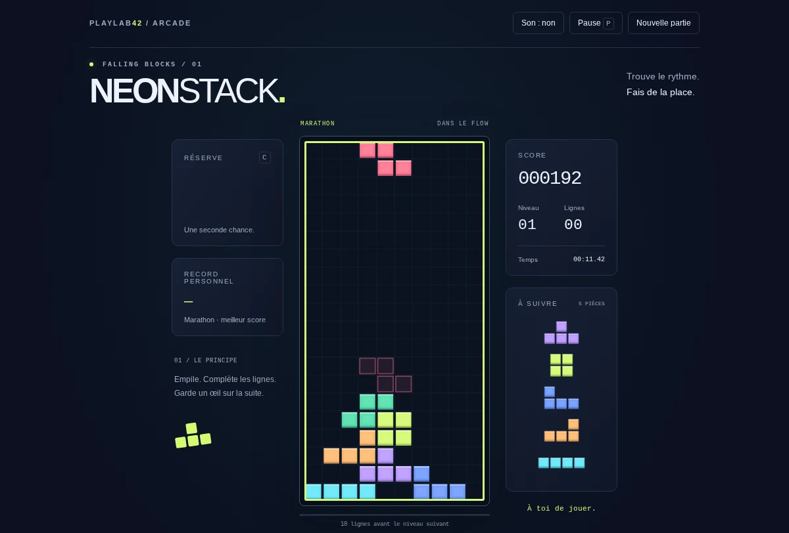
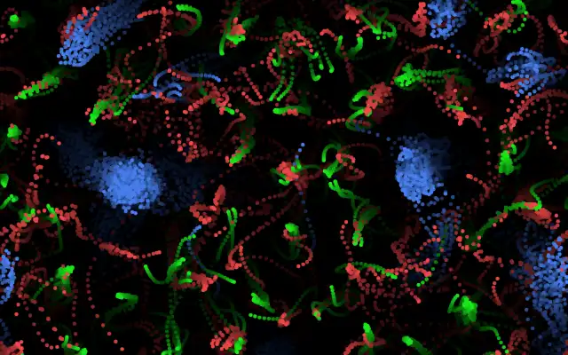
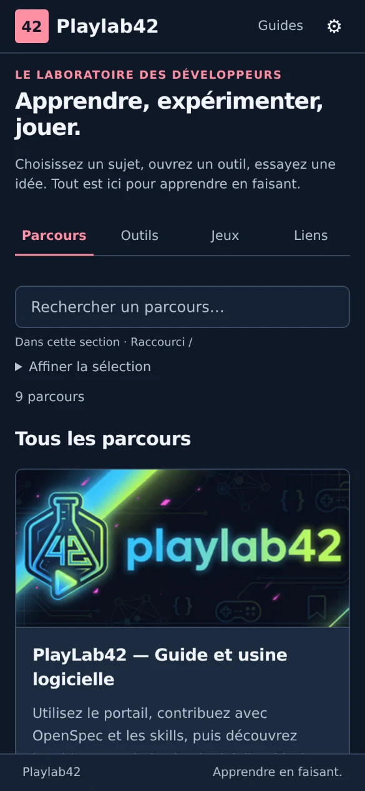

<div align="center">

<sub>Français · [🇬🇧 English](README.en.md)</sub>



# Playlab42

**Comprendre l’IA. Expérimenter en jouant. Construire ensemble.**

Un laboratoire pédagogique ouvert, en français, qui tourne dans le navigateur : parcours interactifs, outils, simulations et jeux pour comprendre l’IA et apprendre à développer avec elle.

[](https://z4ppy.github.io/playlab42/)

[](https://github.com/z4ppy/playlab42/actions/workflows/ci.yml)
[](LICENSE)
[](CONTRIBUTING.md)



</div>

## Ce qu’on y trouve

**Une dizaine de parcours, autant d’outils et de simulations, des jeux** et une bibliothèque de liens, sans compte ni installation.

<table>
<tr>
<td width="33%"><a href="https://z4ppy.github.io/playlab42/#/parcours/anatomie-llm"></a><br><b>Parcours</b> · un token dans un LLM</td>
<td width="33%"><a href="https://z4ppy.github.io/playlab42/tools/l-systems/"></a><br><b>Outils</b> · grammaire → figure</td>
<td width="33%"><a href="https://z4ppy.github.io/playlab42/games/tetris/"></a><br><b>Jeux</b> · règles testées, bots</td>
</tr>
<tr>
<td colspan="2"><a href="https://z4ppy.github.io/playlab42/tools/particle-life/"></a><br><b>Simulations</b> · Particle Life, quelques règles et un monde émerge</td>
<td align="center"><br><b>Mobile</b> · aussi sur téléphone</td>
</tr>
</table>

**Première visite ?** Ouvrez [la démo](https://z4ppy.github.io/playlab42/) et commencez par le parcours [« PlayLab42 — Guide et usine logicielle »](https://z4ppy.github.io/playlab42/#/parcours/hello-playlab42).

## Pourquoi Playlab42

- **Zéro friction.** Un site statique : rien à installer, et vos préférences, scores et progression restent dans votre navigateur. Thèmes clair et sombre, navigation au clavier.
- **On comprend en manipulant.** Les parcours embarquent de vraies démonstrations : grilles d’attention, tokenizers, réseaux de neurones, simulations.
- **Un vrai projet, ouvert au regard.** Moteurs de jeux déterministes, tests Jest et Playwright, specs OpenSpec, CI/CD et audits de sécurité : les bonnes pratiques sont visibles, pas seulement racontées.
- **Fait pour être étendu.** Un manifest, un dossier, une pull request : votre outil, jeu ou parcours rejoint le catalogue.
- **Prêt pour les agents IA.** Les [instructions pour agents](AGENTS.md) et les [skills du projet](docs/guides/project-skills.md) sont versionnées avec le code.

## Démarrage rapide

Prérequis : Git et [Node.js](https://nodejs.org/) 24 ou plus. Comptez environ 2 minutes.

```bash
git clone https://github.com/z4ppy/playlab42.git && cd playlab42
npm ci
npm start        # puis ouvrir http://localhost:5242
```

Vous préférez Docker, ou travaillez sur plusieurs branches en parallèle ? Le [guide de démarrage](docs/GETTING_STARTED.md) détaille l’environnement Docker, les commandes du quotidien et les éléments optionnels (laboratoire GPT-2, aperçus des liens).

## Contribuer

Une petite contribution peut devenir un excellent support de formation : un outil, un jeu, un bot, un parcours, une ressource, une correction. Tout est résumé dans [CONTRIBUTING.md](CONTRIBUTING.md). Une question, une idée ? Les [modèles d’issues](https://github.com/z4ppy/playlab42/issues/new/choose) vous guident.

## Documentation

| Pour… | Lire |
|-------|------|
| Installer et travailler au quotidien | [Guide de démarrage](docs/GETTING_STARTED.md) |
| Comprendre l’architecture et la stack | [Architecture](docs/ARCHITECTURE.md) |
| Créer un outil, un jeu ou un parcours | [Index des guides](docs/guides/README.md) |
| Notions, tests, déploiement, dépannage | [Concepts](docs/CONCEPTS.md) · [Tests](docs/TESTING_STRATEGY.md) · [Déploiement](docs/DEPLOYMENT.md) · [Dépannage](docs/TROUBLESHOOTING.md) |
| Suivre l’évolution du projet | [Changelog](CHANGELOG.md) · [Spécifications OpenSpec](openspec/specs/) |

Sécurité : [SECURITY.md](SECURITY.md), sans passer par une issue publique · Communauté : [code de conduite](CODE_OF_CONDUCT.md) · Merci aux [contributeurs](https://github.com/z4ppy/playlab42/graphs/contributors) !

## Licence

Projet personnel de Cyrille ([@z4ppy](https://github.com/z4ppy)), ouvert aux contributions et distribué sous licence [Apache 2.0](LICENSE) (voir la [notice](NOTICE)). Les composants tiers (`vendor/`, tokenizers et modèles du parcours « Anatomie d’un LLM », etc.) gardent leur propre licence, indiquée dans leur dossier.

---

*Pourquoi « 42 » ? Un clin d’œil à Douglas Adams et à la grande question sur la vie, l’univers et le reste. Ici, on commence par expérimenter.*
