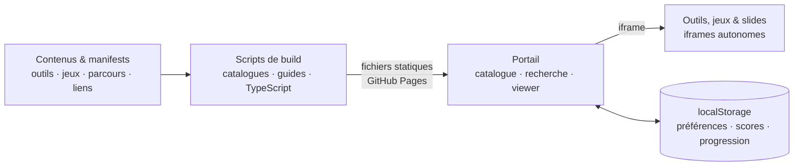

# Architecture en bref

**Un site statique, des contenus autonomes, un socle partagé.** Cette page donne
la vue d’ensemble ; le guide [Architecture](guides/architecture.md) détaille
chaque composant, ses contrats et l’usine logicielle.



En texte : contenus et manifests → scripts de build → fichiers statiques
servis tels quels → portail, qui ouvre outils, jeux et slides dans des iframes
et garde l’état de l’utilisateur dans `localStorage`.

Les scripts préparent les catalogues, les guides et les dépendances destinées
au navigateur, et transpilent les contenus TypeScript **avant** la mise en
ligne. À l’usage, le navigateur charge des fichiers statiques : aucune API
applicative, base de données serveur ni authentification n’est nécessaire.

Les outils et les jeux peuvent aussi être ouverts en dehors du portail. Les
bibliothèques de `lib/` apportent les briques communes : thèmes, générateur
aléatoire déterministe, viewer de parcours et **GameKit**, le SDK de
communication entre les jeux et le portail. Préférences, scores et progression
restent stockés dans le navigateur, sans synchronisation entre appareils.

## Stack

| Couche | Technologies |
|--------|--------------|
| Interface | HTML, CSS, JavaScript en modules ES ; TypeScript optionnel, transpilé avant usage |
| Construction | Node.js 26 dans Docker et la CI (minimum 24), esbuild, scripts de génération |
| Qualité | Jest, Playwright, ESLint, Biome, vérification des types TypeScript, OpenSpec |
| Environnement | Node.js local, ou Docker, Docker Compose et Make |
| Livraison | GitHub Actions → GitHub Pages |
| Travail assisté par IA | [Instructions pour agents](../AGENTS.md), [skills de projet](guides/project-skills.md), [spécifications OpenSpec](../openspec/specs/) |

## Se repérer dans le dépôt

```text
playlab42/
├── index.html, app.js, style.css  # Entrée du portail
├── app/                           # Modules du portail
├── tools/                         # Outils HTML et mini-apps JS/TS
├── games/                         # Interfaces, moteurs de règles et bots
├── parcours/epics/                # Parcours, manifests et slides
├── bookmarks/                     # Ressources externes classées par thème
├── lib/                           # GameKit, thèmes, viewer et utilitaires
├── scripts/                       # Génération des catalogues et build TS
├── data/                          # Catalogues générés, non versionnés
├── site/                          # Archive publique préparée, non versionnée
├── docs/                          # Guides et documentation
├── templates/                     # Gabarits de jeux, outils et parcours
├── e2e/                           # Parcours navigateur Playwright
├── openspec/                      # Spécifications et propositions de changement
├── .github/skills/                # Skills de projet versionnés
└── .github/workflows/             # CI, audits et déploiement
```

## Pour aller plus loin

- [Architecture détaillée](guides/architecture.md) : portail, outils, jeux (moteur, client, bot), parcours, données et usine logicielle.
- [Guide de démarrage](GETTING_STARTED.md) : installer l’environnement et les commandes du quotidien.
- [Build des catalogues](CATALOGUE-BUILD.md) : comment les manifests deviennent des catalogues.
- [Usine logicielle](guides/software-factory.md) : chaîne de livraison, preuves attendues et points à améliorer.
